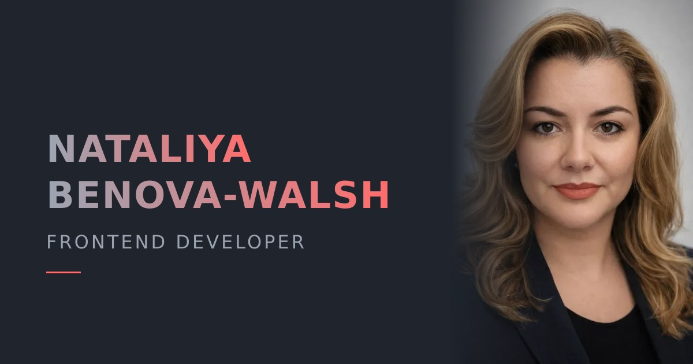

# Nataliya Benova-Walsh — Personal Website

[](https://github.com/NataliyaBenova-Walsh/my-personal-website/actions/workflows/ci.yml)

My portfolio site as a frontend developer: who I am, what I've built, and how to reach me.

**[Visit the live site →](https://my-personal-website-omega-seven.vercel.app/)**

[](https://my-personal-website-omega-seven.vercel.app/)

## Sections

- **About:** background, primary stack, other tools, and languages
- **Education:** Software University and University of National and World Economy
- **Experience:** professional timeline
- **Projects:** featured work, including AMA Coach (React, TypeScript, realtime AI over WebSocket), SemantifAI, and MyHACCP, plus client websites
- **Contact:** email, LinkedIn, GitHub, and a downloadable CV

## Tech stack

- **React 18** with functional components
- **Vite** for development and production builds
- **Font Awesome** icons
- Hand-written, responsive **CSS**
- Images compressed to **WebP**, plus Open Graph and Twitter meta tags for link previews
- **ESLint** with React and hooks rules, checked in CI
- Deployed on **Vercel**

## Run locally

```bash
npm install
npm run dev       # http://localhost:5173
```

| Script            | Description                     |
| ----------------- | ------------------------------- |
| `npm run dev`     | Start the dev server            |
| `npm run build`   | Build for production to `dist/` |
| `npm run preview` | Preview the production build    |
| `npm run lint`    | Run ESLint                      |

## Project structure

```
public/              Favicon, Open Graph image, CV
src/
  assets/            Project screenshots (WebP)
  components/        Header, Navbar, Home, About, Experience, Projects
  App.jsx            Page layout, education, and contact sections
  App.css            Styles
```
